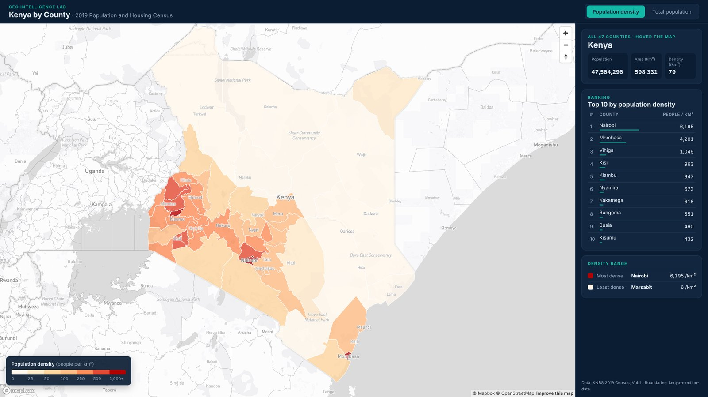

# Choropleth Maps with React + Mapbox GL JS

Source code for the Geo Intelligence Lab video **"Choropleth Maps in React + Mapbox GL JS: Counts vs Rates, the Right Way"**.

A choropleth map of Kenya's 47 counties from the 2019 Census, built with React, TypeScript, Vite and Mapbox GL JS.



## What's inside

| Folder | What it is |
|---|---|
| [`starter/`](starter) | The code-along starting point: map centred on Kenya, data ready, no layers yet |
| [`final/`](final) | The finished app shown in the video |

The finished app covers:

- **Counts vs rates:** switch between total population and population density (people per km²)
- **Data-driven styling:** a 7-class `step` expression built from one config of class breaks and colours
- **Hover with `feature-state`:** `promoteId` gives every county an id, and only the hovered county restyles
- **Instant metric switching:** `setPaintProperty` recolours the map without reloading the GeoJSON
- **One source of truth:** the legend uses the same breaks and colours as the map
- **Sidebar:** county details, national totals, and a top-10 ranking that follows the active metric

## Run it

You need Node.js 20+ and a free [Mapbox access token](https://account.mapbox.com/).

```bash
cd final            # or: cd starter
npm install
cp .env.example .env
# put your public token (pk.…) in .env as VITE_MAPBOX_TOKEN
npm run dev
```

Then open http://localhost:5173.

## The data

- `public/data/kenya-counties.geojson`: 47 counties with `code`, `county`, `population`, `area_km2` and `density`
- `scripts/prepare-data.mjs`: joins the census figures to the boundaries, computes area with Turf, and simplifies the shapes with mapshaper

Area is computed from the boundary geometry, so densities differ slightly from the KNBS published densities, which use land area.

**Sources**

- Population: Kenya National Bureau of Statistics, 2019 Kenya Population and Housing Census, Volume I
- County boundaries: [mikelmaron/kenya-election-data](https://github.com/mikelmaron/kenya-election-data)

## More

- 🎥 Video: new web mapping tutorial every Thursday on [Geo Intelligence Lab](https://www.youtube.com/@GeoIntelligenceLab)
- 🧰 Free GIS Developer Starter Kit: [pagea.uk/developerkit](https://pagea.uk/developerkit)
- 💼 Work with me: [johnsaita.github.io](https://johnsaita.github.io)
